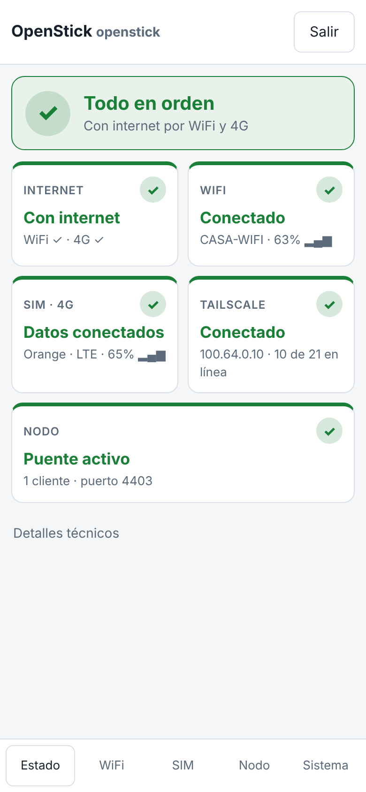
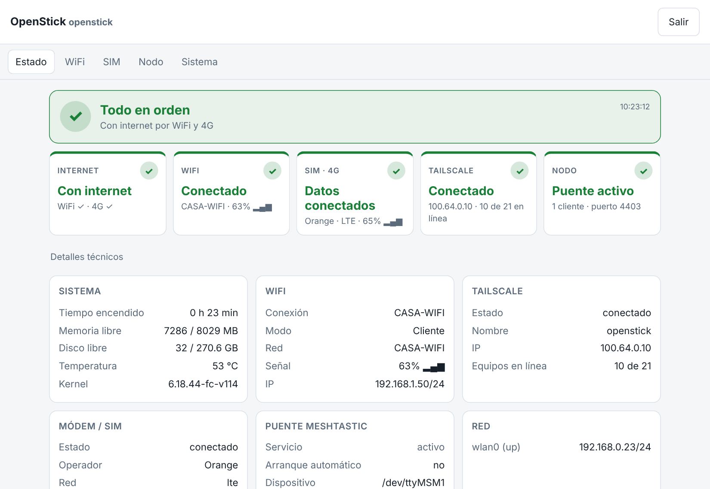
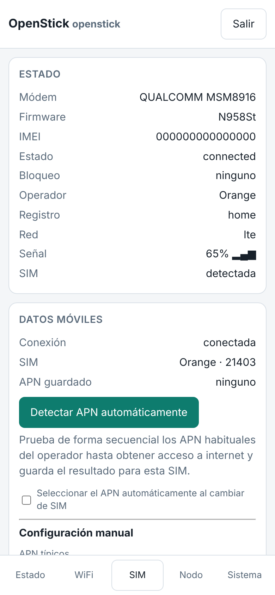

# OpenStick Dashboard

Panel de administración web, ligero y adaptado a móvil, para sticks 4G con chip MSM8916 (por ejemplo UZ801) que ejecutan **OpenStick Debian**. Un único archivo Python sin dependencias externas.

## Funciones

- **Estado**: indicadores de semáforo para WiFi, SIM/4G, Tailscale y nodo, con lista de incidencias y detección del acceso a internet por cada vía (WiFi y 4G).
- **WiFi**: búsqueda de redes, asistente de conexión y gestión del punto de acceso.
- **SIM y 4G**: APN predefinidos por operador, detección y prueba automática de APN, memoria del APN por SIM, desbloqueo de PIN con recordatorio y desbloqueo automático.
- **Puente serie↔TCP** (puerto 4403) para conectar un nodo Meshtastic por UART, accesible por Tailscale.
- **Sistema**: cambio de usuario y contraseña, reinicio y utilidades.
- Autenticación con usuario y contraseña, bloqueo tras intentos fallidos y cookie de sesión `HttpOnly`.

## Requisitos

- Stick con OpenStick Debian (NetworkManager y ModemManager).
- Python 3 y acceso `root`.
- Tailscale (opcional, recomendado).

## Instalación

```sh
scp openstick-panel.py install.sh usuario@IP_DEL_STICK:/tmp/
ssh usuario@IP_DEL_STICK
cd /tmp && sudo sh install.sh
```

El panel queda en el puerto **80** del servicio `openstick-panel` y escucha en las direcciones de Tailscale, del punto de acceso (`192.168.100.1`) y de USB (`192.168.101.1`).

## Acceso inicial

Usuario `admin`, contraseña `admin`. **Cámbiela de inmediato** en la pestaña *Sistema*.
Para restablecer las credenciales: `sudo openstick-panel reset-credentials`.

## Seguridad

- No exponga el panel a internet; úselo a través de Tailscale o de la red local del stick.
- El PIN y los APN guardados se almacenan en texto plano en `/etc/openstick-panel/config.json` (permisos 0600, directorio 0700).
- El panel se ejecuta como root, por lo que debe protegerse con una contraseña robusta.

## Pruebas

```sh
sh tests/run.sh
```

Ejecuta las pruebas de API y de APN contra el panel con comandos simulados (`tests/bin`), sin necesidad de hardware. Requiere Playwright solo para las pruebas con navegador.

## Estructura

| Ruta | Contenido |
|---|---|
| `openstick-panel.py` | Panel completo (servidor, API e interfaz) |
| `install.sh` | Instalador y unidades systemd |
| `tests/` | Pruebas y simulaciones de comandos |
| `docs/img/` | Capturas (con datos de ejemplo) |

## Capturas




